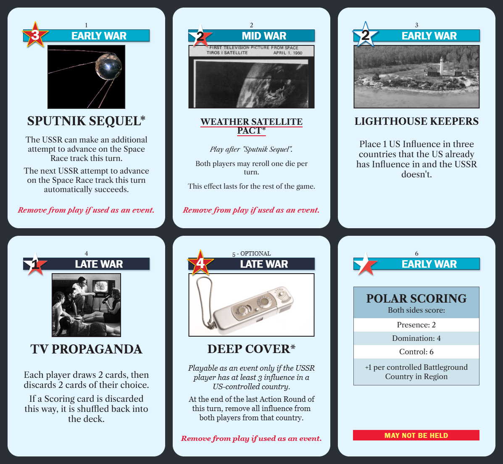

# Twilight Struggle Card Generator

A local tool for designing custom Twilight Struggle cards, keeping them in a
hand-editable library, and exporting them as PNGs or a Tabletop Simulator deck.



*The cards above are the original examples in `library/examples/`.*

It started as a rebuild of the browser-only generator by *mootoyoutoo* (see
Credits). The original's card geometry and palette were the starting point; the
geometry has since been re-measured against reference scans, and everything else
— the library, the importer, scoring cards, mini-cards and the Tabletop
Simulator export — is new.

> Unofficial fan tool, not affiliated with or endorsed by GMT Games. Twilight
> Struggle is their work. This repository contains no GMT card text, card art,
> scans or game data — see *Bulk import* for how to bring your own.

## Running it

```bat
start.bat
```

or, on any platform:

```bash
node server.js
```

That launches a small Node server on `http://127.0.0.1:8731/` (loopback only).
There are **no dependencies** — nothing to `npm install`. It uses only Node's
built-in modules and was developed and tested on Node 24.

To use a different port, set `TSCG_PORT` before running. Run the tests with
`npm test` (or `node --test`).

Why a server rather than just opening an HTML file:

- a plain `<a download>` can only ever write to your Downloads folder
- cross-origin images **taint the canvas**, which makes `toDataURL()` throw —
  so web-URL artwork is impossible without a server-side fetch
- the card library, spreadsheet import and TTS export all need real files

Rendering still happens entirely in the browser canvas, so there is exactly one
rendering path: the TTS atlas is pixel-identical to the live preview.

## Writing card text

The effect box is a single free-form field. Newlines are respected, and a blank
line makes a wider paragraph gap.

| Markup | Result |
|---|---|
| `*text*` | *italic* |
| `**text**` | **bold** |
| `***text***` | ***bold italic*** |
| `\*` | a literal asterisk |

<kbd>Ctrl</kbd>+<kbd>I</kbd> and <kbd>Ctrl</kbd>+<kbd>B</kbd> wrap the selection.
Markup works in the title too.

Leave **Body font size** on *Auto-fit* and the text shrinks to fit the card by
itself; pick a fixed size to override.

## Artwork

Four ways in, all of which store the image under `library/_images/` and
reference it by relative path so the library stays portable:

- the file picker
- <kbd>Ctrl</kbd>+<kbd>V</kbd> anywhere outside a text field — pastes an image
  from the clipboard, or fetches a pasted image URL
- drag a file or a link onto the preview
- paste a URL into the **Image URL** box and hit Fetch

## Library

Cards are individual JSON files under `library/`. Folders are real directories,
so you can rename or reorganise them in Explorer and hit Refresh. Drag a card
onto a folder in the sidebar to move it; right-click to rename or delete.

**Import** takes CSV or TSV — copying a block straight out of Excel gives you
TSV, which works as-is. A header row is required; recognised columns are
`number`, `ops`, `title`, `era`, `association`, `text`, `removed`, `optional`,
`permanent` and `scoring`, matched loosely (`side`, `faction` and `deck` also
work).

## Bulk import from the game's own data

`tools/import.js` reads a Twilight Struggle card table — the Lua file the Steam
client ships, `twilight_cards.lua` — as a complete 114-card manifest, optionally
merging a reskin overlay from a spreadsheet.

**You supply that file yourself.** It is GMT's data, so it is not included in
this repository, and neither is any imported card text or artwork: `library/` is
gitignored apart from `library/examples/`.

```bash
node tools/import.js --lua path/to/twilight_cards.lua --out vanilla
```

```bash
node tools/import.js --lua path/to/twilight_cards.lua --xlsm path/to/my_reskin.xlsx --sheet "My Reskin" --images path/to/art --out my-reskin
```

A reskin overrides title, text and artwork; ops, era, association and the
removal/underline flags carry over from the vanilla card, and `vanillaTitle`
records what each is standing in for. Only the fields needed to *draw* a card
are read — the lua's effect opcodes are deliberately left alone, since they
belong to a rules engine.

The overlay sheet is found by header name (`#`/`number`, `name`, `text`,
`image`), so columns can be added or reordered. A Name cell longer than 48
characters is assumed to be a planning note rather than a title; that row is
skipped with a warning and keeps its vanilla name.

### The red underline

Per the rulebook (§7.3, §2.2.5), an underlined title means the Event's effects
**last for the duration of the game** — such cards sit face-up beside the board
until cancelled or the game ends. The test is *permanence*, not merely "has a
lasting effect": an event that expires at end of turn does not qualify, however
much bookkeeping it needs.

The manifest encodes exactly this in the argument to `PutThisCardInPlay`:

| Marker | Meaning | Underlined |
|---|---|---|
| `PutThisCardInPlay, 0` | in play indefinitely | yes |
| `PutThisCardInPlay, 1` | in play for the turn | no |
| `PutThisCardInPlaySpecial` | in play until cancelled (Shuttle Diplomacy) | yes |
| `PutThisCardInPlayWithRegionChoice` | clears at end of turn (Chernobyl) | no |

Quagmire and Bear Trap are added by hand — they last until the trapped player
rolls out, via bespoke opcodes nothing structural catches. That yields **20
cards**.

Verified by measuring the red rule directly on twelve reference scans: NATO,
NORAD, Quagmire and Flower Power underlined; Containment, Brezhnev Doctrine,
Red Scare/Purge, Latin American Death Squads, We Will Bury You, Missile Envy,
Socialist Governments and Indo-Pakistani War not. All twelve agree.

Corrections go in `tools/underline-overrides.json` (by card name or number) so
the list can be tuned by eye without touching code.

## Card JSON

Game-relevant fields sit at the top level. Everything about how the card *looks*
is quarantined under `art` and `presentation`:

```json
{
  "schema": 1,
  "id": "weather-satellite-pact",
  "number": 2,
  "ops": 2,
  "era": "mid",
  "association": "neutral",
  "title": "Weather Satellite Pact",
  "text": "*Play after \"Sputnik Sequel\".*\n\nBoth players may reroll one die per turn…",
  "removedOnEvent": true,
  "optional": false,
  "permanent": true,
  "scoring": false,
  "art": { "src": "examples/_images/tiros-1-first-tv-image.jpg", "mode": "photo" },
  "presentation": { "barColor": "#7a1fa2", "bannerText": "COLD OPEN" }
}
```

`presentation` only records deliberate overrides. Anything absent is derived
from the era and association presets, so changing a card's era updates its
colours automatically.

This split is deliberate: a rules engine can read these files for game data and
ignore `art`/`presentation` entirely. That data boundary is the intended
integration point — not shared code.

## Reskinning

Open **Reskin & overrides** to change the banner text, bar colour, star fill and
outline, ops-number colour, card colour, accent colour and the red footer line.
The banner and star are drawn procedurally, so nothing is locked to the three
stock eras or to USSR/USA/Neutral.

The era and association colours in `js/cardmodel.js` were sampled from the
printed cards, and the banner, star and scoring-panel geometry were measured
off reference scans (see *Card geometry* below).

## Exporting

**Export PNG** writes the current card at 1x, 2x or 3x to the folder configured
under Settings (default: `output/`).

**Render selected** batch-renders either the ticked cards or, if nothing is
ticked, the whole library. Tick **Selection mode** in the sidebar to choose.
Every batch also writes an **`index.json`** manifest beside the images:

```json
{
  "schema": 1,
  "generatedAt": "2026-08-20T04:19:09.961Z",
  "count": 114,
  "cards": [
    { "number": 21, "id": "nato", "title": "NATO",
      "file": "021 - NATO.png", "mini": "mini/021 - NATO.png",
      "ops": 4, "era": "early", "association": "usa",
      "scoring": false, "optional": false,
      "removedOnEvent": true, "permanent": true,
      "source": "my-reskin/021 - NATO.json" }
  ]
}
```

That manifest is the intended handoff to anything consuming the images — a
rules engine or board UI looks a card up by number instead of guessing at
filenames. It is deliberately the only coupling between this tool and whatever
reads its output.

Ticking **Also render mini-cards** additionally writes the small hand-display
cards (title, cropped art, ops flanked by association stars) into a `mini/`
subfolder, matching the row along the bottom of the Steam client.

**Build TTS deck** writes a face atlas, a card back and a Tabletop Simulator
saved-object JSON into `output/TTS/<deck name>/`. Atlas sheets hold up to 10x7
cards; more than 70 cards produces multiple sheets. Tiles are square-cornered
because TTS applies its own card mask. Copy that folder into TTS's
`Saves/Saved Objects` directory, or point the `FaceURL`/`BackURL` entries at a
host if you want to share the deck.

## Fonts

Two faces are selectable per card under **Reskin & overrides → Text face**:

| Option | Notes |
|---|---|
| **Libre Caslon** | Bundled in `public/fonts/`, so it renders identically on any machine. Closer to Adobe Caslon in *style* — more stroke contrast, more delicate. |
| **Georgia** | A system font on Windows and macOS. Closer to Adobe Caslon in *metrics*. |

Measured against the reference scans, **Georgia is the better match**: on the
NATO card it reproduces the printed line breaks exactly (three body lines,
identical break points) where Libre Caslon needs four, and its old-style
numerals match the printed cards' figures. Libre Caslon is the safer choice if
the tool ever runs somewhere without Georgia installed.

To change the default for every card, set `DEFAULT_FONT` in
`public/js/cardmodel.js`. Per-card overrides win over it either way.

Both Libre Caslon faces are SIL Open Font License 1.1; the licences ship
alongside them.

Note that the original tool's CSS referenced `files/fonts/*.ttf`, a directory
that was never present in the distribution — which is why its italics silently
fell back to an upright default. The `@font-face` rules here declare normal and
italic under **one** family name, which is what lets the canvas ask for
`italic 700 20px TSCaslon` and actually get it.

## Card geometry

The banner, star and scoring panel are drawn to measurements taken off the
375×525 reference scans rather than eyeballed:

| Element | Value |
|---|---|
| Era bar | x 37–337, y 52–80 (29px tall), 1px `#1E4157` keyline |
| Banner text | 25.5px Franklin Gothic Medium, no letter-spacing, 18px cap height, centred at x 223 |
| Star | centre (66, 66), radius 33; neutral drawn at 0.93 scale and 3px lower |
| Star outline | 2px stroke, which reproduces the reference's measured 3px band |
| Scoring panel | x 37–337 from y 121, 32px per line of row text |
| "May not be held" bar | y 462, 25px tall, `#ED1B34` with `#FFF261` text |

### Stars

Measured radially at ten angles on the reference scans:

- **USSR and USA** carry a *thin* outline — a 3px median band, reproduced by a
  2px stroke (the fill is inset by radius, not by perpendicular distance, so
  the two numbers differ).
- **Neutral** carries **no outline at all**, only a drop shadow. A dark band
  appears outside its edge going downward and nowhere else, which is a shadow,
  not a stroke.
- The neutral red/white split is **not vertical**: it runs at 36° off vertical,
  measured identically on two independent cards. That is half a five-pointed
  star's 72° spacing, so the line joins the lower-left point to the upper-right
  inner notch.

## Scoring cards

Ticking **Scoring card** switches to the banded panel layout. The effect text
drives it directly: a first line ending in a colon becomes the panel header,
and every line after it becomes its own banded row, 32px per line of text.

```
Both sides score:
Presence: 3
Domination: 5
Control: 7
+1 per controlled Battleground Country in Region
```

Rows shrink automatically so five-row regions (Asia, Europe) still fit above the
**May not be held** bar.

**Each scoring card is tinted to match its region on the map**, so there is no
single scoring palette. `scoringRegion` on the card selects it:

| Region | Header band | Row band |
|---|---|---|
| Asia | `#F4AD43` | `#FACE8D` |
| Europe | `#A796CA` | `#C7C8E4` |
| Middle East | `#C7EAFD` | `#C7EAFD` |
| Central America | `#D9E2A3` | `#D9E2A3` |
| Southeast Asia | `#F2A41C` | `#FFD503` |
| Africa | `#FFEC95` | `#FFEC95` |
| South America | `#A0C987` | `#CCE0BD` |

Four regions use a darker header over lighter rows; the other three use one
colour for both. Southeast Asia Scoring is the one scoring card removed after
play (§7.2) and gets a red *"Remove from play after scoring."* line above the
bar instead of the usual footer.

## Layout

```
server.js            zero-dependency local server
start.bat            Windows launcher
package.json         scripts only; no dependencies
config.json          created on first save; holds your export folder (gitignored)
library/             your cards, as JSON, in real folders (gitignored except examples/)
  examples/          original example cards, committed
  _images/           stored artwork, content-addressed
output/              rendered PNGs and TTS decks (gitignored)
test/                node:test suite and synthetic fixtures
docs/                README screenshot
public/
  index.html
  css/app.css
  fonts/
  js/
    text.js          markup parsing, wrapping, styled drawing
    cardmodel.js     schema, defaults, era/association presets, geometry
    render.js        card face, back and scoring-panel rendering
    mini.js          hand-display mini-cards
    tts.js           atlas compositing
    library.js       sidebar tree
    api.js           server API wrapper
    app.js           form wiring and live preview
tools/
  import.js          bulk import from twilight_cards.lua (+ xlsm overlay)
  xlsx.js            minimal stdlib-only xlsx/xlsm reader
  underline-overrides.json   manual corrections to the underline derivation
```

## Credits

Twilight Struggle is copyright GMT Games. The browser-only card generator this
project grew out of was made by
[mootoyoutoo](http://twitter.com/mootoyoutoo2) and hosted by yzemaze
([source tarball](https://yzemaze.de/tscardgen/TSCardGenerator.tar.gz)); none of
its code or images are included here.

The bundled Libre Caslon fonts are under the SIL Open Font License 1.1; the
licences are in `public/fonts/`.

## Licence

[MIT](LICENSE) for the code in this repository. That does not extend to
Twilight Struggle itself, which is GMT Games' property.

## How this was built

Written in collaboration with an AI coding assistant (Claude Code). The part
worth reading is the method rather than the volume of code: card geometry,
star outlines, the neutral star's 36° split and the scoring-panel layout were
all *measured* off reference scans with pixel probes, and the same probe was
then run against this tool's own render to calibrate it. The red-underline rule
was derived from the rulebook and then verified against twelve scans.
